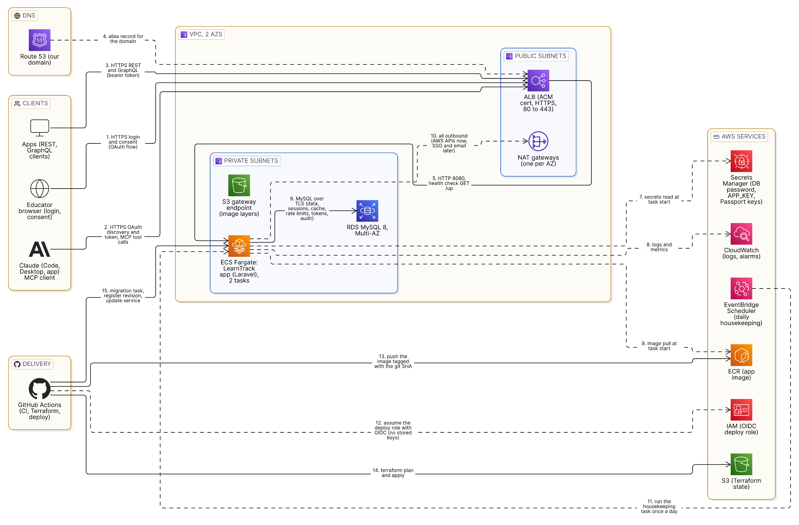

# LearnTrack

LearnTrack is a backend service for medical schools and teaching hospitals. Educators teach groups of learners, for example a cohort of third-year students or residents on a rotation, and assign them articles and question sets with due dates. Today an educator finds out who needs help by opening every group and scanning long progress tables, so struggling learners are often noticed after several due dates have passed.

With LearnTrack the educator connects an AI assistant such as Claude once, with their own login, and asks in plain language: "Which learners in Cardiology Group A are behind?" Claude answers with the reasons (an overdue question set, an average score below 50), and the educator can act in the same conversation: assign content or move a due date, approving each change. Claude sees only the groups the educator teaches, gets names and progress but never emails, and can never delete anything. Apps use the same rules through a REST and GraphQL API.



## Local setup

Needs Docker, PHP 8.5 with Composer, and Node 24.

```
cp .env.example .env
composer install && npm ci
php artisan key:generate
php artisan passport:keys       # token signing keys in storage/, for tests run on the host
docker compose up -d            # app on http://localhost:8080, MySQL 8 on port 3306
php artisan migrate --seed      # demo data
npm run dev                     # Vite, for the three pages
```

The app container serves the assets built into its image. After a frontend change, run `docker compose up -d --build`. For hot reload, stop the app container with `docker compose stop app` and run `php artisan serve --port=8080` next to `npm run dev`, so the app keeps its APP_URL address.

Tests run against MySQL, in the `learntrack_test` database that compose creates. Copy the test settings once with `cp .env.testing.example .env.testing`. Larastan needs a PHP `memory_limit` of at least 256M. The checks to run before every pull request are listed in [CLAUDE.md](CLAUDE.md).

## Demo data

`php artisan migrate --seed` creates two institutions, 6 educators, 300 learners, 12 groups and the content library. Every password is `password`. Faker uses a fixed seed, so every machine gets the same names, groups and progress. Due dates count from the day you seed.

| Account | Role | Where |
|---|---|---|
| `anna.keller@example.edu` | educator | Northside Medical School (Europe/Berlin). Teaches Cardiology Group A, Nephrology Group A and Neurology Group A |
| `sara.lindqvist@example.edu` | learner | Northside, in Cardiology Group A. Behind: her first question set is overdue |
| `emily.carter@example.edu` | learner | Riverside College of Medicine (Europe/London), in Endocrinology Group A. Behind: her average score is 35 |

The other educators are `jonas.weber`, `miriam.hoffmann`, `oliver.bennett`, `priya.shah` and `hannah.clarke`, all `@example.edu`.

Every group has 20 to 60 learners and 5 to 12 assignments:

- The first assignment is a question set of the group's topic, due 3 to 30 days ago. Learners who are behind by overdue work have not completed it.
- The second is due 3 to 30 days ahead. The last two target a few learners only.
- Every group has at least one learner behind by overdue work, one behind by a low average and one on track.

On the day you seed, the groups look like this (the overdue numbers grow as due dates pass):

| Institution | Group | Educators | Learners | Behind | Overdue only | Low average only | Both |
|---|---|---|---|---|---|---|---|
| Northside | Cardiology Group A | Anna Keller, Jonas Weber | 43 | 20 | 10 | 8 | 2 |
| Northside | Cardiology Group B | Jonas Weber | 26 | 10 | 7 | 3 | 0 |
| Northside | Pulmonology Group A | Miriam Hoffmann | 39 | 13 | 6 | 7 | 0 |
| Northside | Nephrology Group A | Anna Keller | 20 | 10 | 6 | 3 | 1 |
| Northside | Neurology Group A | Miriam Hoffmann, Anna Keller | 50 | 30 | 19 | 10 | 1 |
| Northside | Pediatrics Group A | Jonas Weber | 55 | 28 | 14 | 11 | 3 |
| Riverside | Endocrinology Group A | Oliver Bennett | 45 | 24 | 10 | 12 | 2 |
| Riverside | Cardiology Group C | Priya Shah, Hannah Clarke | 58 | 27 | 15 | 7 | 5 |
| Riverside | Pulmonology Group B | Hannah Clarke | 56 | 27 | 12 | 13 | 2 |
| Riverside | Nephrology Group B | Oliver Bennett, Priya Shah | 48 | 23 | 14 | 6 | 3 |
| Riverside | Neurology Group B | Priya Shah | 29 | 14 | 8 | 5 | 1 |
| Riverside | Pediatrics Group B | Hannah Clarke | 50 | 19 | 14 | 1 | 4 |

A learner is behind when an assignment is past its due date and not completed, or when their average score over completed question sets is below 50.

## REST and GraphQL quick start

The contracts are [docs/api-contract.md](docs/api-contract.md) (REST and the GraphQL error shape) and the GraphQL schema in [docs/tdd.md](docs/tdd.md). Against the local stack:

Log in and keep the API token (valid 8 hours):

```
TOKEN=$(curl -s -X POST http://localhost:8080/api/v1/auth/login \
  -H 'Content-Type: application/json' -H 'Accept: application/json' \
  -d '{"email":"anna.keller@example.edu","password":"password"}' \
  | php -r 'echo json_decode(stream_get_contents(STDIN))->data->token;')
```

List the groups you teach:

```
curl -s http://localhost:8080/api/v1/groups -H "Authorization: Bearer $TOKEN" -H 'Accept: application/json'
```

Ask GraphQL who is behind in group 1 and why:

```
curl -s -X POST http://localhost:8080/graphql -H "Authorization: Bearer $TOKEN" -H 'Content-Type: application/json' \
  -d '{"query":"query ($groupId: ID!) { groupProgress(groupId: $groupId) { group { name } learners { learner { name } behind reasons } } }","variables":{"groupId":"1"}}'
```

## Connect Claude

The MCP server is `https://<host>/mcp`, where `<host>` is the domain of your environment. Locally it is `http://localhost:8080/mcp`. Each educator connects with their own login:

1. You add the server in Claude. Claude calls it, gets a 401, reads the discovery documents and registers itself as an OAuth client.
2. Claude opens the LearnTrack login page in your browser. Log in with your educator account.
3. The consent page shows the client's name and what it will be able to do: read the progress of your groups, assign content, change due dates. Choose Approve.
4. The browser goes back to Claude, and the tools are ready. Claude refreshes its token by itself for 30 days.

Only educators can connect. A learner who logs in sees a message that only educators can connect an AI assistant, and Claude gets no access.

**Claude Code.** Run this, then `/mcp` in Claude Code to log in:

```
claude mcp add --transport http learntrack https://<host>/mcp
```

Claude Code also connects to the local stack over plain http: use `http://localhost:8080/mcp`.

**Claude Desktop.** Open Settings, then Connectors, and add a custom connector named LearnTrack with the URL `https://<host>/mcp`. Choose Connect and follow the login and consent steps. Claude Desktop needs https: use your environment, or an https tunnel to port 8080 with APP_URL in `.env` set to the tunnel's address.

**The Claude app.** The Claude app on the web, iOS and Android uses the connectors of your Claude account. Add LearnTrack once in Settings, then Connectors (the same steps as Claude Desktop), and it is ready in the app too.

Five questions to start with, as Anna Keller:

1. Which groups do I teach?
2. Who is behind in Cardiology Group A, and why?
3. How is Sara Lindqvist doing?
4. Which assignments in Neurology Group A are the hardest?
5. Assign the Hypertension Pharmacology Question Set to the learners who are behind in Cardiology Group A, due next Friday.

Claude asks before it changes anything, and the answer says exactly what changed.

## Deployment

LearnTrack runs on AWS: two ECS Fargate tasks behind a load balancer, RDS MySQL Multi-AZ, and a daily housekeeping task, all in Terraform. [infra/README.md](infra/README.md) has the details: variables, roles, secrets and costs.

**Bootstrap, once per AWS account.** With admin credentials, fill in `infra/bootstrap/terraform.tfvars` from its example (the region, `<domain>`, the GitHub OIDC subject and the alarm email), then run `terraform init` and `terraform apply` in `infra/bootstrap`. Then delegate `<domain>` to the four name servers it prints, confirm the alarm email, and set the GitHub repository variables from its outputs. The steps are in [infra/README.md](infra/README.md) (Bootstrap, GitHub variables).

**The pipeline.** Every pull request runs the checks and `terraform validate`, and a pull request that changes `infra/` also gets the plan as a comment. A push to `main`:

1. builds the image and pushes it to ECR, tagged with the git SHA;
2. applies Terraform in `infra/env`;
3. runs the migrations as a one-off task, and stops if they fail;
4. moves the service to the new image and waits until it is stable;
5. moves the daily housekeeping task to the new image.

The app then answers on `https://<domain>`, so `<host>` above is `<domain>`. A new environment starts with an empty database: the pipeline runs the migrations only. Seeding it for the first login is part of the launch check, [ticket 15](docs/tickets/15-launch-check.md).

**Roll back.** A new image that fails the `/up` health check is rolled back by ECS by itself. To go back to an earlier deploy, move the service to that run's app revision with one command, as in [infra/README.md](infra/README.md) (Roll back). Migrations only add, so an older image runs on the newer schema.

**Destroy and rebuild.** To stop paying, run the destroy workflow from `main` (Actions, destroy, Run workflow) and type `destroy`. The bootstrap stays: the state, the roles, the images, the hosted zone and the confirmed alarm email. To rebuild, run the deploy workflow from `main` or push to `main`. This deploy takes about 20 minutes longer than a normal one, because RDS Multi-AZ is created again.

## Documents

Everything about the design is in [docs/](docs/):

- [blueprint.md](docs/blueprint.md): the problem, the users and the goals.
- [requirements.md](docs/requirements.md): what the system must do.
- [tdd.md](docs/tdd.md): the technical design: tables, layering, the behind rule, rate limits, security, launch plan.
- [api-contract.md](docs/api-contract.md) and [mcp-tools.md](docs/mcp-tools.md): the exact REST, GraphQL and MCP contracts.
- [adr/](docs/adr/README.md): the architecture decisions and why they were made.
- [tickets/](docs/tickets/README.md): the work, one ticket per pull request.
- [review-lessons.md](docs/review-lessons.md): rules added after reviews.
- [infra/README.md](infra/README.md): the Terraform layout.
